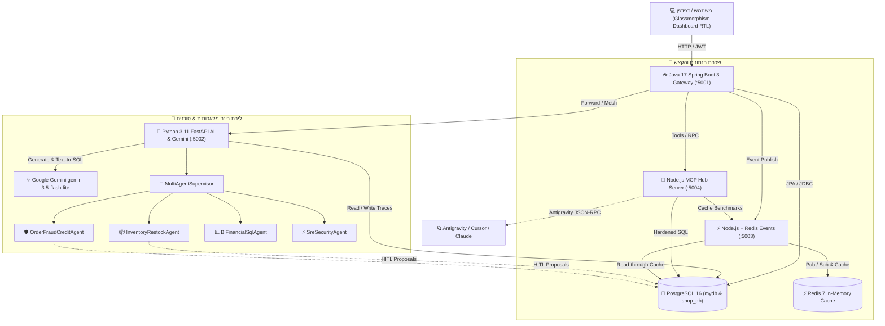

<div align="center">

# 🐘 Enterprise Microservices Mesh & Multi-Agents AI Hub
### 🚀 Version 4.1 — Google Gemini 3.5 Flash-Lite Edition 🧠🔐

[](https://github.com/IDAN2468D/my-postgres/actions)
[](https://www.docker.com/)
[](https://ai.google.dev/)
[](https://www.postgresql.org/)
[](https://spring.io/projects/spring-boot)
[](https://fastapi.tiangolo.com/)
[](https://redis.io/)
[](https://modelcontextprotocol.io/)

<br/>

**מערכת Enterprise Microservices Mesh ובינה מלאכותית מבוזרת (Multi-Agent AI & Google Gemini) בריצת Docker מלאה.**  
שילוב מתקדם של שער **Java 17 Spring Boot 3 JWT Gateway**, מנוע **Python 3.11 FastAPI** מונע **Google Gemini (`gemini-3.5-flash-lite`)** וצוות **4 סוכני AI מומחים**, אפיק אירועים וקאש **Node.js 20 + Redis 7**, מסד נתונים **PostgreSQL 16 Alpine (`mydb` + `shop_db`)**, ושרת **Model Context Protocol (MCP)** עם **13 כלים מוקשחים** המחובר ל-**Antigravity**.

[✨ תכונות מרכזיות](#-תכונות-מרכזיות) • [🏗️ ארכיטקטורה](#️-ארכיטקטורת-המערכת) • [🤖 Google Gemini](#-בינה-מלאכותית-google-gemini-35-flash-lite) • [🧠 צוות סוכני AI](#-צוות-סוכני-ai-ו-human-in-the-loop) • [🛠️ שרת MCP](#️-שרת-mcp-hub--13-כלים-מוקשחים) • [🚀 התקנה והרצה](#-התקנה-והרצה-מהירה-docker) • [🧪 בדיקות CI](#-בדיקות-ו-ci-pipeline)

</div>

---

## ✨ תכונות מרכזיות

- 🤖 **Google Gemini (`gemini-3.5-flash-lite`) מובנה:**
  - **Co-Pilot & Text-to-SQL:** תרגום שאלות בעברית לשאילתות `SELECT` מוקשחות וניתוח חי של נתוני PostgreSQL.
  - **עוזר קטלוג חכם (1-Click):** חישוב אוטומטי של קטגוריה, תמחור מומלץ ב-`₪`, כמות מלאי ונימוק שיווקי.
  - **סינתזת מנהלים לצוות הסוכנים:** סיכום אופרטיבי חכם עבור כל ריצה של ה-`MultiAgentSupervisor`.
  - **היברידיות וזמינות 100%:** תמיכה בחיבור חי ל-Google Cloud REST API לצד מנוע הקשרי חכם מקומי במצב אופליין ובדיקות.
- 🧠 **Multi-Agent AI Orchestration (`v4.0`):** מפקח עליון (`Supervisor`) ו-4 סוכנים מתמחים (מלאי, אשראי והונאות, BI פיננסי, SRE ואבטחה) עם מנגנון אישור אנושי (**Human-in-the-Loop - HITL**).
- 🌐 **Fullstack Microservices Mesh:** שבעה שירותים עצמאיים ברשת פנימית מבודדת ב-Docker (`my-docker-context_app-network`).
- 🔐 **אבטחת מידע ארגונית ו-JWT:** אימות `JSON Web Token` מלא לפי תקן `RFC 7519`, הצפנת סיסמאות `BCrypt` ורישום פעולות ביומן אבטחה (`audit_logs`).
- ⚡ **האצת Redis 7 & Event Bus:** קאש מבוזר עם האצה של **פי 20+** מול PostgreSQL, בדיקת ביצועים בלייב ופיד התראות בזמן אמת.
- 🛠️ **שרת MCP תקני (JSON-RPC 2.0):** 13 כלים מאובטחים לקריאה וכתיבה מבוקרת, תמיכה בעסקאות `READ ONLY` עם `statement_timeout = 3000ms`.
- 📊 **דשבורד Glassmorphism בעברית מלאה:** ממשק מתקדם ב-7 לשוניות עם תמיכת RTL, גרפים חיים וייצוא נתונים ל-CSV/JSON.

---

## 🏗️ ארכיטקטורת המערכת



---

## 🐳 מפת הקונטיינרים והמיקרו-סרביסים ב-Docker

| שירות | קונטיינר | שפה וטכנולוגיה | פורט חיצוני | תפקיד בארכיטקטורה |
| :--- | :--- | :--- | :--- | :--- |
| **webapp** | `my-webapp` | **Java 17 + Spring Boot 3.2.5** | `5001` | שרת ראשי, JWT Gateway, דשבורד 7 לשוניות וסוואגר |
| **analytics-service** | `my-analytics-service` | **Python 3.11 + FastAPI** | `5002` | מנוע Gemini 3.5 Flash-Lite, תזמור סוכני AI ו-BI רב-מטבעי |
| **events-service** | `my-events-service` | **Node.js 20 + Express** | `5003` | סנכרון קאש ב-Redis, מבחני ביצועים ושידור התראות |
| **mcp-server** | `my-mcp-server` | **Node.js 20 (JSON-RPC 2.0)** | `5004` | שרת MCP מוקשח (13 כלים) לשאילתות, הצלבות מסדים ו-AI |
| **postgres** | `my-postgres` | **PostgreSQL 16 Alpine** | `5433:5432` | מסד הנתונים הראשי (`mydb`) ומסד לקוחות חיצוני (`shop_db`) |
| **redis** | `my-redis` | **Redis 7 Alpine** | `6380:6379` | שכבת זיכרון מהירה ו-Event Bus (`system:events`) |
| **adminer** | `my-adminer` | **Adminer Web GUI** | `8088` | ממשק אינטרנטי לניהול טבלאות ושאילתות SQL |

---

## 🤖 בינה מלאכותית: Google Gemini (`gemini-3.5-flash-lite`)

המערכת משלבת את מנוע **Google Gemini** באופן הדוק לכל רכיבי האפליקציה:

```
                  ┌──────────────────────────────────────────────┐
                  │   Google Gemini (gemini-3.5-flash-lite)      │
                  └──────┬───────────────┬──────────────┬────────┘
                         │               │              │
        ┌────────────────┴────┐   ┌──────┴───────┐   ┌──┴──────────────────┐
        │ 1-Click Product AI  │   │  Text-to-SQL │   │ Executive Synthesis │
        │   המלצת מחיר ומלאי   │   │  שאלות בעברית │   │   סיכום צוות סוכנים   │
        └─────────────────────┘   └──────────────┘   └─────────────────────┘
```

1. **Co-Pilot & Text-to-SQL בלשונית הסוכנים:**  
   הקלד שאלה בעברית חופשית (למשל: *"אילו מוצרים נמצאים במלאי קריטי ומה שווי המלאי?"*), והמנוע ייצר שאילתת SQL מוקשחת, יריץ אותה מול PostgreSQL ויספק תשובה מנומקת בזמן אמת.
2. **עוזר קטלוג חכם בטופס הוספת מוצר (`➕ מוצר חדש`):**  
   בלחיצה אחת על **`✨ המלצת מחיר, קטגוריה ומלאי עם Gemini 3.5 Flash-Lite`**, המערכת סורקת את המוצר, מתאימה קטגוריה, קובעת מחיר מומלץ וכמות מלאי פתיחה, ומייצרת סלוגן שיווקי.
3. **תובנות BI פיננסיות מועשרות (`/api/analytics/insights`):**  
   ניתוח יחס מחזור-למלאי, פילוח סלי קנייה (AOV) והמלצות אופרטיביות לשערי מט"ח (`ILS / USD / EUR / GBP`).

---

## 🧠 צוות סוכני AI ו-Human-in-the-Loop

בלשונית **"🧠 צוות סוכני AI (Multi-Agents)"** בדשבורד פועל **`MultiAgentSupervisor`** המפעיל 4 סוכנים מתמחים:

| סוכן | תפקיד | כלי MCP מופעלים | פעולת HITL לאישור |
| :--- | :--- | :--- | :--- |
| **`InventoryRestockAgent`** 📦 | סוכן ניהול מלאי ורכש | `list_inventory_products`, `create_or_update_product` | יצירת הצעת רכש (`+20` יח') למוצרים במלאי קריטי (`<= 5`) |
| **`OrderFraudCreditAgent`** 🛡️ | סוכן אשראי חוצה-מסדים | `list_or_filter_orders`, `cross_db_customer_profile`, `update_order_workflow_status` | הצלבת הזמנות `pending` מול `shop_db` וקידום ל-`shipped` |
| **`BiFinancialSqlAgent`** 📊 | סוכן BI פיננסי ו-Text-to-SQL | `get_ai_business_insights`, `postgres_query_readonly` | זיהוי מלאי עודף (`>= 30`) להצעות באנדל והמרות מט"ח |
| **`SreSecurityAgent`** ⚡ | סוכן SRE, ביצועי קאש ואבטחה | `get_system_mesh_health`, `redis_cache_benchmark`, `get_audit_trail` | סריקת בריאות ה-Mesh, בדיקת האצת Redis וביקורת לוגים |

> [!IMPORTANT]
> **מנגנון Human-in-the-Loop (HITL):**  
> פעולות המשנות נתונים ב-PostgreSQL (עדכון מלאי או שינוי סטטוס הזמנה) אינן מבוצעות ישירות, אלא נשמרות בטבלת `agent_approvals` בסטטוס `PENDING`. מנהל המערכת מאשר (`APPROVE`) או דוחה (`REJECT`) את הפעולה מהדשבורד לפני הרצתה ב-MCP.

---

## 🛠️ שרת MCP Hub — 13 כלים מוקשחים

שרת ה-MCP (`:5004/mcp/rpc`) מספק ממשק **JSON-RPC 2.0** רשמי המחובר ל-Antigravity, וכולל 13 כלים:

1. `postgres_query_readonly` — הרצת שאילתות `SELECT` מוקשחות בטרנזקציית `READ ONLY` עם `statement_timeout = 3000ms`.
2. `get_system_mesh_health` — בדיקת תקינות וזמני תגובה (`ms`) של כל 5 המיקרו-סרביסים.
3. `list_inventory_products` — שליפת קטלוג מוצרים וסינון מלאי נמוך (`stock <= 5`).
4. `create_or_update_product` — הוספה ועדכון מוצרים ומלאי ב-PostgreSQL דרך MCP.
5. `get_ai_business_insights` — שליפת תובנות עסקיות והמרת מטבעות מ-FastAPI.
6. `redis_cache_benchmark` — סנכרון קאש ומבחן מהירות PostgreSQL מול Redis 7.
7. `emit_realtime_alert` — שידור התראה חיה לאפיק האירועים ב-Redis.
8. `get_audit_trail` — שליפת יומן האבטחה והפעילות (`audit_logs`).
9. `list_or_filter_orders` — שליפת הזמנות בצירוף פרטי לקוח מ-`users` וסינון לפי סטטוס.
10. `update_order_workflow_status` — עדכון סטטוס הזמנה וסנכרון מלאי חוזר אוטומטי בביטול.
11. `cross_db_customer_profile` — הצלבת פרופיל לקוחות ויתרות אשראי בין `mydb.users` ל-`shop_db.customers`.
12. `list_pending_agent_approvals` — שליפת הצעות סוכנים הממתינות לאישור אנושי.
13. `ask_gemini_flash_lite` — שאילתת AI חכמה מול Gemini 3.5 Flash-Lite עם הקשר חי של נתוני PostgreSQL.

---

## 🔌 מפרט נקודות קצה ב-Gateway (`Spring Boot :5001`)

```http
### בדיקת בריאות וזמינות המיקרו-סרביסים
GET /api/mesh/status

### תובנות עסקיות מועשרות ב-Gemini
GET /api/mesh/analytics

### המרת מחירי קטלוג למט"ח (USD / EUR / GBP / ILS)
GET /api/mesh/currency?currency=USD

### צ'אט אינטראקטיבי ו-Text-to-SQL עם Gemini 3.5 Flash-Lite
POST /api/mesh/gemini/chat
Content-Type: application/json

{
  "prompt": "אילו מוצרים נמצאים במלאי קריטי ומה הפדיון הכולל?"
}

### עוזר חכם להמלצת מחיר וקטגוריה
POST /api/mesh/gemini/product-assist
Content-Type: application/json

{
  "product_name": "אוזניות אלחוטיות Sony WH-1000XM5"
}

### הרצת משימת צוות סוכני AI
POST /api/mesh/agents/run
Content-Type: application/json

{
  "prompt": "סריקה מלאה של כל המערכת",
  "auto_execute": false
}

### אישור או דחייה של הצעת סוכן (Human-in-the-Loop)
POST /api/mesh/agents/approve/{id}
Content-Type: application/json

{
  "action": "APPROVE",
  "reviewed_by": "מנהל מערכת"
}

### סנכרון קאש ומבחן מהירות מול Redis 7
POST /api/mesh/cache-sync
```

---

## 🚀 התקנה והרצה מהירה (Docker)

### דרישות קדם
- **Docker Desktop** (עם תמיכת Docker Compose v2)
- **Git**
- (אופציונלי להרצה מקומית) Java 17, Python 3.11, Node.js 20

### 1. שכפול המאגר
```bash
git clone https://github.com/IDAN2468D/my-postgres.git
cd my-postgres
```

### 2. הגדרת משתני סביבה (`.env`)
העתק את קובץ הדוגמה והגדר את מפתח ה-Gemini שלך (ניתן גם להשאיר ריק לעבודה במנוע ההקשרי המובנה):
```bash
cp .env.example .env
```
בתוך `.env`:
```env
GEMINI_MODEL=gemini-3.5-flash-lite
GEMINI_API_KEY=your_google_gemini_api_key_here
```

### 3. הרמת כל 7 השירותים ב-Docker
```bash
docker compose up -d --build
```

### 4. כניסה לממשקים
| ממשק | כתובת מקומית | פרטי כניסה / שימוש |
| :--- | :--- | :--- |
| 🖥️ **דשבורד ראשי** | [http://localhost:5001](http://localhost:5001) | כניסה מהירה בלחיצה: `idan@example.com` / `password123` |
| 📖 **Swagger UI** | [http://localhost:5001/swagger-ui/index.html](http://localhost:5001/swagger-ui/index.html) | בדיקת כל נתיבי ה-REST API בדפדפן |
| 🐘 **Adminer Web DB** | [http://localhost:8088](http://localhost:8088) | Server: `postgres` • User: `postgres` • Pass: `password` |
| 🐍 **FastAPI Docs** | [http://localhost:5002/docs](http://localhost:5002/docs) | תיעוד OpenAPI של שירות ה-AI והסוכנים |
| 🤖 **MCP Server Info** | [http://localhost:5004/health](http://localhost:5004/health) | סטטוס ורשימת 13 הכלים |

---

## 🧪 בדיקות ו-CI Pipeline

הפרויקט כולל פייפליין **GitHub Actions** מלא (`.github/workflows/ci.yml`) המריץ 6 עבודות בדיקה בכל `push` ו-`pull request`:

```bash
# 1. בדיקות Java Spring Boot 3 (JUnit 5 + MockMvc + H2 In-Memory)
mvn test -f server/pom.xml

# 2. בדיקות Python FastAPI, Gemini & Multi-Agents
python -m unittest discover -s analytics-service -p "test_*.py" -v

# 3. בדיקות Node.js Events & Redis
npm test --prefix events-service

# 4. בדיקות Node.js MCP Hub (13 Tools + SQL Hardening)
npm test --prefix mcp-server

# 5. אימות תצורת Docker Compose
docker compose config --quiet
```

---

## 👥 מחברים ורישיון

- **פותח ומנוהל ע"י:** [IDAN2468D](https://github.com/IDAN2468D)
- **רישיון:** [MIT License](LICENSE)
- **גרסה נוכחית:** `v4.1.0 (Google Gemini 3.5 Flash-Lite & Multi-Agent Mesh)`
